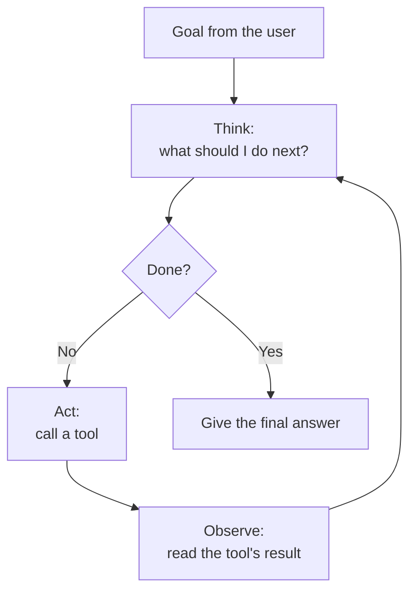

# What Are AI Agents? Tools, Planning and Memory Explained

> **Type:** Concept explainer · **Audience:** Beginners and non-technical teammates · **Reading time:** 7 minutes

A chatbot answers. An **AI agent** acts.

Ask a chatbot "What's the weather in Shillong?" and it can only tell you what it remembers from training, which may be months old. Ask an agent, and it can decide to call a weather service, read the result, and tell you today's forecast.

An AI agent is a system in which a language model **decides what to do next, takes an action using a tool, looks at the result, and repeats** until the task is done.

This page explains the three building blocks that turn a chatbot into an agent: **tools**, **planning** and **memory**.

## Chatbot vs agent

| | Chatbot | AI agent |
|---|---|---|
| What it produces | Text | Text **and** actions |
| Steps per request | One | As many as the task needs |
| Can use outside information | Only what you paste in | Yes, by calling tools |
| Example | "Write me an email to my landlord" | "Find my landlord's last email, draft a reply, and save it as a draft in Gmail" |

## The agent loop

Every agent, from a simple demo to a coding assistant, runs some version of this loop:



1. **Think.** The model reads the goal and everything that has happened so far, and decides the next step.
2. **Act.** It asks to use a tool, for example "search the web for X" or "run this code".
3. **Observe.** The program runs the tool and gives the result back to the model.
4. **Repeat** until the model decides the goal is met.

A useful detail: **the model never runs anything itself.** It only writes a request like *"call `get_weather` with city = Shillong"*. Your program checks that request, runs the real function, and returns the result. This is what keeps agents controllable.

## Building block 1: Tools

A **tool** is a function the agent is allowed to call. You describe each tool to the model in plain language: its name, what it does and what inputs it needs.

```json
{
  "name": "get_weather",
  "description": "Get today's weather forecast for a city.",
  "parameters": {
    "city": { "type": "string", "description": "City name, e.g. Shillong" }
  }
}
```

The model reads these descriptions and decides when a tool would help. Common tools include web search, reading files, querying a database, sending an email and running code.

> 💡 **The description is documentation.** A model chooses tools based on how they're described, so a vague description ("does weather stuff") leads to wrong choices. Writing clear tool descriptions is one of the most important parts of building an agent.

## Building block 2: Planning

For multi-step tasks, the agent has to work out an order of operations. Given *"Compare the refund policies in these three PDFs and email me a summary"*, a good plan might be:

1. Read PDF 1 and note the refund rules.
2. Read PDF 2 and note the refund rules.
3. Read PDF 3 and note the refund rules.
4. Write a comparison.
5. Send the email.

Some agents write a full plan first and then follow it. Others decide one step at a time and adjust when something unexpected happens, for example when a file turns out to be empty. Most real agents mix both approaches.

## Building block 3: Memory

A language model doesn't remember anything between calls. Everything it "knows" about the current task has to be sent to it each time. Agents handle this with two kinds of memory:

| Type | What it holds | Example |
|---|---|---|
| **Short-term** (working memory) | The conversation and tool results for the current task | "I already read PDF 1; refunds are within 30 days." |
| **Long-term** | Facts saved between sessions, usually in a database | "This user prefers summaries as bullet points." |

Short-term memory is limited by the model's [context window](tokens-and-context-windows.md). Long tasks can fill it up, so agents often summarise older steps to make room.

## Why agents fail, and how builders guard against it

| Failure | Example | Guard rail |
|---|---|---|
| Wrong tool or wrong input | Searches for "Shilong" and finds nothing | Clear tool descriptions; validate inputs before running |
| Loops forever | Keeps retrying the same failed search | Set a maximum number of steps |
| Takes a risky action | Deletes a file it shouldn't | Ask a human to approve destructive actions |
| Trusts bad information | A web page contains false or malicious instructions | Treat tool results as data, not commands |

## Summary

- An agent is a language model in a loop: **think → act → observe → repeat**.
- **Tools** let it take actions; the program, not the model, actually runs them.
- **Planning** breaks a goal into steps.
- **Memory** carries information across steps (short-term) and across sessions (long-term).
- Good agents have limits: step caps, input checks and human approval for risky actions.

## Next steps

- See how agents look up information in documents: [How RAG Works](how-rag-works.md)
- Learn why memory runs out: [Tokens and Context Windows](tokens-and-context-windows.md)

---

<details>
<summary><strong>Writer's notes</strong>: decisions behind this piece</summary>

- **Lead with a contrast.** "A chatbot answers. An agent acts." gives the reader the whole idea in six words before any detail.
- **One loop diagram, used throughout.** Tools, planning and memory are each explained as a part of that loop, so readers build one mental model instead of three.
- **"The model never runs anything itself"** is the single most common misconception I hear, so it gets its own paragraph.
- **The tool-description callout** connects agents back to documentation: a reminder that clear writing directly affects how well AI systems work.

</details>
