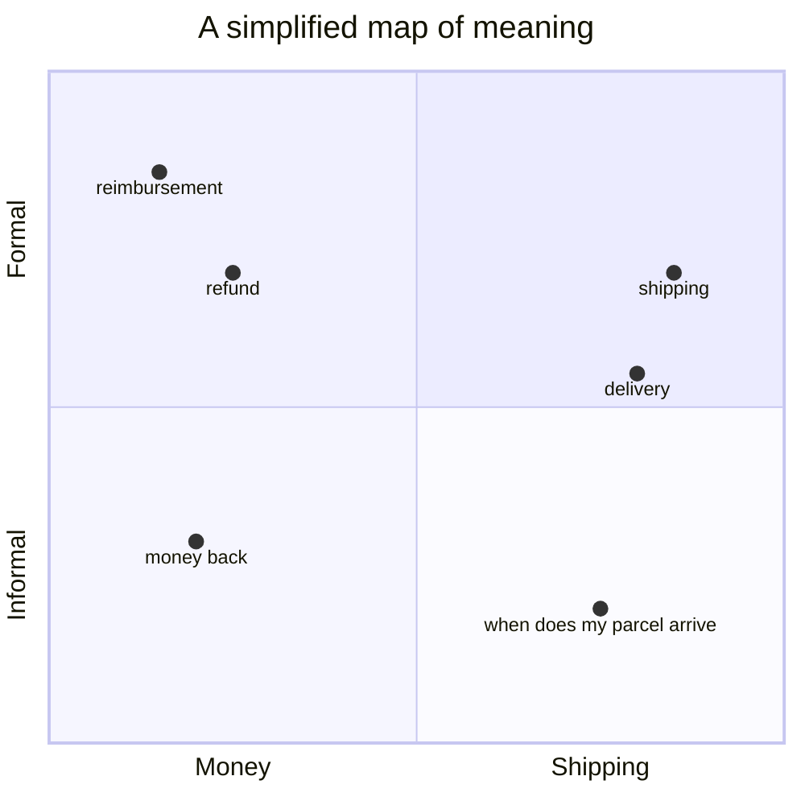

# Embeddings Explained Without the Maths

> **Type:** Concept explainer · **Audience:** Beginners · **Reading time:** 5 minutes

Computers are good with numbers and bad with meaning. To a computer, the words *"refund"* and *"money back"* share no letters, so they look completely unrelated.

An **embedding** is a way of turning a piece of text into a list of numbers so that **texts with similar meanings get similar numbers.** Once meaning is expressed as numbers, a computer can measure how close two ideas are.

Embeddings are what make AI search, recommendations and [RAG](how-rag-works.md) work.

## An everyday comparison: a map of meaning

Imagine a map where every word or sentence is a pin, placed so that things with similar meanings sit close together.

On this map:

- "refund", "reimbursement" and "money back" sit close together, because they mean nearly the same thing.
- "shipping" and "delivery" form their own cluster, far from the money cluster.
- A full question such as *"when does my parcel arrive"* lands near the shipping words, even though it doesn't contain the word "shipping".

Each pin's position can be written as coordinates: two numbers on this flat map. That pair of numbers is a (very small) embedding.

## From two numbers to hundreds

A flat map has only two directions, which isn't enough to capture everything about meaning: topic, tone, tense, whether it's a question, and much more.

Real embedding models use **hundreds of directions** instead of two. A small, popular model called `all-MiniLM-L6-v2` turns any text into a list of **384 numbers**. You can't picture a 384-direction map, but the idea is exactly the same: similar meaning, nearby position.

Nobody chooses what each direction means. An **embedding model** learns the positions by reading huge amounts of text and noticing which words and sentences appear in similar contexts.

## What you can do with embeddings

| Use | How embeddings help |
|---|---|
| **Search by meaning** | Find "money back" when someone searches "refund" |
| **RAG** | Find the passages in your documents most relevant to a question |
| **Recommendations** | "People who read this article also liked…" |
| **Grouping** | Sort thousands of support tickets into topics automatically |
| **Duplicate detection** | Spot two questions that are worded differently but ask the same thing |

## How "closeness" is measured

To compare two embeddings, a program calculates a **similarity score**, usually between 0 and 1 for text:

- close to **1**: very similar meaning
- close to **0**: unrelated

You don't need the formula to use it. In practice you embed your documents once, embed each question as it arrives, and ask for "the 5 passages with the highest similarity score".

## Things to keep in mind

- **Use the same model for everything.** Embeddings from two different models are like coordinates on two different maps. They can't be compared.
- **Embeddings capture meaning, not facts.** "The refund window is 30 days" and "The refund window is 60 days" get very similar embeddings, because they're about the same thing. Embeddings find the right *topic*; the language model still has to read the actual text.
- **Exact terms can slip through.** Product codes, error numbers and names don't always embed well. Many systems combine embedding search with ordinary keyword search for this reason.
- **They can run on your own computer.** Small models like `all-MiniLM-L6-v2` are free and run on an ordinary laptop, so your text never leaves your machine.

## Summary

- An embedding turns text into a list of numbers that represents its meaning.
- Similar meanings produce nearby numbers, so computers can measure how related two texts are.
- Embeddings power meaning-based search, RAG, recommendations and grouping.
- Always compare embeddings made by the same model.

## Next steps

- See embeddings at work in a full system: [How RAG Works](how-rag-works.md)
- Use them in code: [Build a PDF Q&A App in 30 Minutes](../tutorials/pdf-qa-app-30-minutes.md)

---

<strong>Writer's notes</strong>: decisions behind this piece

- **Promise kept: no maths.** No vectors, dot products or cosine formulas. The reader only needs to know "closer means more similar".
- **2D first, then scale up.** A map with two directions is easy to picture; stating that real models use 384 directions lets readers extend the same idea without needing to visualise it.
- **The "30 days vs 60 days" caveat** prevents a common misunderstanding: that embedding search alone gives correct answers.
- **Concrete numbers** (384, the model name) come from the model I use in my own projects, so they're checkable rather than vague.

