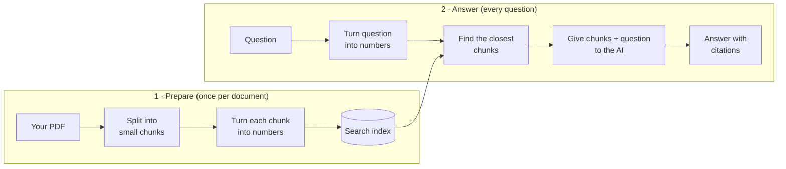

# How RAG Works: Giving AI Access to Your Documents

> **Type:** Concept explainer · **Audience:** Beginners, no coding needed · **Reading time:** 6 minutes

An AI chatbot like ChatGPT or Gemini knows a lot about the world. It knows nothing about *your* documents: your company's refund policy, your class notes, last month's meeting minutes. If you ask it about them, it will either say it doesn't know or, worse, make up something that sounds right.

**Retrieval-Augmented Generation (RAG)** fixes this. Before the AI answers, the system finds the parts of your documents that are relevant to the question and gives those parts to the AI to read. The AI then answers using that text.

By the end of this page you will understand:

- why AI models can't read your files on their own
- the two halves of a RAG system and what each one does
- why RAG answers can point to the exact page they came from
- where RAG goes wrong

## The problem: an AI only knows what it was trained on

A large language model (LLM) learns by reading a huge amount of public text once, during training. After that, its knowledge is frozen. It has never seen your private PDF, and it can't open one on its own.

You *could* paste your whole document into the chat. That works for a two-page file. It doesn't work for a 400-page manual, because every model has a limit on how much text it can read at once (its [context window](tokens-and-context-windows.md)). Long inputs are also slower and cost more.

RAG solves this by sending the model only the few paragraphs it actually needs.

## An everyday comparison: the open-book exam

Think of an exam where you are allowed to bring the textbook.

You don't read the whole book when a question comes up. You flip to the index, find the two or three pages that look relevant, read them, and write your answer, maybe noting "see page 42".

RAG does the same thing:

| Open-book exam | RAG system |
|---|---|
| The textbook | Your uploaded documents |
| The index | A search index built from your documents |
| Flipping to the right pages | **Retrieval:** finding the relevant passages |
| Writing the answer from those pages | **Generation:** the AI writes an answer from the passages |
| "See page 42" | A citation pointing to the source page |

## How it works, step by step

A RAG system has two stages. The first happens once, when you upload a document. The second happens every time someone asks a question.

### Stage 1: Prepare the documents

1. **Split the document into chunks.** A chunk is a short piece of text, usually a paragraph or two. Small pieces make search more precise: you want to find the paragraph about refunds, not the whole 50-page policy.
2. **Turn each chunk into a list of numbers.** This list is called an [embedding](embeddings-explained.md). Chunks that mean similar things get similar numbers, even if they use different words.
3. **Store the chunks in a search index.** Each chunk is saved with its embedding and a note of where it came from, such as the file name and page number.

### Stage 2: Answer a question

1. **Turn the question into numbers** the same way.
2. **Find the closest chunks.** The system compares the question's numbers with every chunk's numbers and picks the few that match best. This is the *retrieval* step.
3. **Build a prompt.** The system gives the AI the question, the chunks it found, and an instruction such as *"Answer using only these sources, and say which source you used."*
4. **Generate the answer.** The AI writes the answer from the chunks. This is the *generation* step.

## Why RAG can cite its sources

Because every chunk remembers which file and page it came from, the system knows exactly what the AI was given. If the AI writes "Sale items can't be refunded [1]", the app can show you that source **[1]** is page 2 of `store_policy.pdf`, and you can check it yourself.

This is the biggest practical benefit of RAG. You don't have to trust the AI; you can verify it.

## What RAG is not

- **It doesn't retrain the model.** The model stays the same. It just gets better reading material for each question. Adding a new document takes seconds, not days of training.
- **It isn't a regular keyword search.** A keyword search for "refund" misses a paragraph that says "money back". Embedding-based search finds it, because it compares meaning, not exact words.
- **It doesn't guarantee correct answers.** See the next section.

## Where RAG goes wrong

| Problem | What happens | Common fix |
|---|---|---|
| **Search finds the wrong chunks** | The AI answers from irrelevant text, or says it can't find the answer when it's there | Tune chunk size, retrieve more chunks, add keyword search alongside |
| **The answer isn't in the documents** | The AI may fill the gap with a guess | Instruct the model to say "I couldn't find that" and test that it does |
| **Chunks cut a sentence in half** | Important context is lost | Let neighbouring chunks overlap slightly |
| **Scanned PDFs** | There is no text to extract, only images | Run OCR (text recognition) first |

The only reliable way to know whether a RAG system works is to test it with questions you already know the answers to. See [How to Measure Whether Your RAG Answers Are Accurate](../how-to/measure-rag-accuracy.md).

## Summary

- An AI model can't see your documents, and can't read very long ones in one go.
- RAG **retrieves** the most relevant passages, then the AI **generates** an answer from them.
- Each passage remembers its source, so answers can include page citations you can check.
- RAG reduces made-up answers but doesn't eliminate them, so test it.

## Next steps

- Build one yourself: [Build a PDF Q&A App in 30 Minutes](../tutorials/pdf-qa-app-30-minutes.md)
- Learn what those "lists of numbers" are: [Embeddings Explained Without the Maths](embeddings-explained.md)

---

<strong>Writer's notes</strong>: decisions behind this piece

- **Audience:** someone who uses chatbots but has never heard of embeddings. I avoided the words *vector*, *cosine* and *semantic* in the main text; they appear only through links to deeper pages.
- **Analogy first, diagram second:** the open-book exam gives beginners a mental model before the diagram shows the real components. The mapping table connects the two so the analogy doesn't become a crutch.
- **Honest limits:** I included "Where RAG goes wrong" because docs that oversell a technique erode trust the first time it fails.
- **Grounded in a real build:** the flow and failure modes come from my own [Chat with Docs](https://github.com/gideonswer/chat-with-docs) project.

