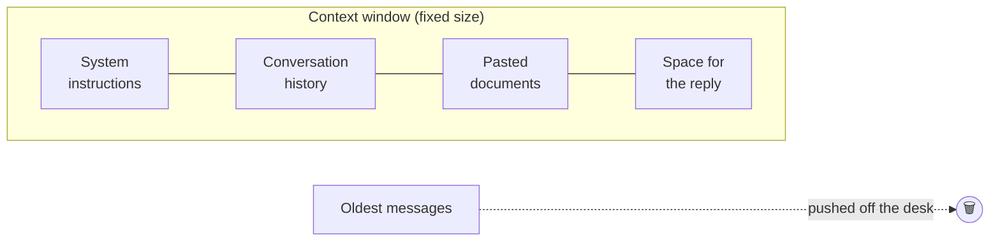

# Tokens and Context Windows: Why AI Forgets

> **Type:** Concept explainer · **Audience:** Beginners and regular AI users · **Reading time:** 5 minutes

You've been chatting with an AI for an hour. Early on, you told it your name and that you're writing a report for your manager. Now it asks, *"Who is this report for?"*

It hasn't malfunctioned. It has run out of room. Every AI model can only "see" a limited amount of text at once, and when a conversation grows past that limit, the oldest parts fall out of view.

This page explains the two ideas behind that behaviour: **tokens** and **context windows**.

## Tokens: how AI reads text

An AI model doesn't read letters or whole words. It reads **tokens**: small chunks of text, often a whole short word or part of a longer one.

| Text | Roughly how a model might split it |
|---|---|
| `cat` | `cat` (1 token) |
| `unbelievable` | `un` · `believ` · `able` (3 tokens) |
| `Shillong` | `Sh` · `ill` · `ong` (3 tokens) |
| `Hello, world!` | `Hello` · `,` · `␣world` · `!` (4 tokens; ␣ is a space) |

Exact splits vary from model to model, but a useful rule of thumb for English is:

> **1 token ≈ ¾ of a word**, so **100 tokens ≈ 75 words**.

Common English words are usually one token. Rare words, names, code and many non-English languages take more tokens for the same amount of meaning.

### Why tokens matter to you

- **Cost.** Paid AI APIs charge per token, for both what you send and what the model writes back.
- **Speed.** More tokens take longer to process.
- **Limits.** Every model has a maximum number of tokens it can handle at once. That limit is the context window.

## The context window: the AI's desk

Picture the model working at a desk. Everything it needs for the current reply has to fit **on the desk**: your instructions, the whole conversation so far, any documents you pasted, and the reply it is writing.

The size of that desk is the **context window**, measured in tokens.

When the desk is full, something has to go. Most chat apps quietly drop or summarise the oldest messages. That's why the AI "forgot" your name: the message where you said it is no longer on the desk.

> 💡 **The model has no memory between requests.** Each time you send a message, the app sends the conversation again from scratch. "Memory" is just whatever the app chooses to put back on the desk.

## How big are context windows?

Sizes have grown fast, from a few thousand tokens in early models to hundreds of thousands, or even millions, in recent ones. A million tokens is several long novels.

Bigger isn't automatically better:

- Filling a large window costs more and takes longer.
- Models can pay less attention to details buried in the middle of very long inputs.

So even with a huge window, sending only the relevant text, which is what [RAG](how-rag-works.md) does, often gives better answers.

## Practical tips

| Situation | What to do |
|---|---|
| The AI forgets early details in a long chat | Restate the key facts, or start a new chat with a short summary |
| You need it to work with a long document | Paste only the relevant sections, or use a RAG tool |
| You're building an app on an AI API | Count tokens before sending, and leave room for the reply |
| Replies get cut off mid-sentence | The output limit was reached; ask it to continue, or raise the maximum output tokens |

Most AI providers offer a way to count tokens before you send a request. For example, the Gemini API has a `count_tokens` method.

## Summary

- AI models read **tokens**, roughly ¾ of an English word each.
- The **context window** is the maximum number of tokens the model can consider at once, including its own reply.
- When a conversation exceeds the window, the oldest content is dropped, so the AI "forgets".
- Sending less, more relevant text usually beats sending everything.

## Next steps

- See how RAG keeps inputs small: [How RAG Works](how-rag-works.md)
- See how agents manage memory: [What Are AI Agents?](ai-agents-explained.md)

---

<strong>Writer's notes</strong>: decisions behind this piece

- **Start with the reader's frustration.** Almost everyone has seen an AI "forget"; opening with that experience answers "why should I care?" immediately.
- **No specific window sizes per model.** Those numbers change every few months and would make the page go stale. I explain the concept and the trade-offs, which stay true.
- **The token table is marked as approximate**, because exact splits differ by tokenizer and I don't want readers treating it as a reference.
- **Ends with a symptom → action table**, so the explainer is useful in practice, not just interesting.

