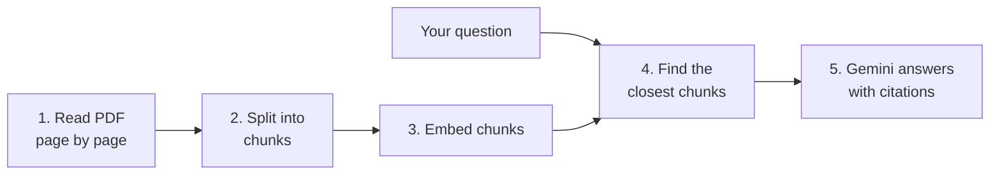

# Build a PDF Q&A App in 30 Minutes

> **Type:** Tutorial · **Audience:** Beginner developers who know basic Python · **Time:** 30 minutes · **Cost:** Free

In this tutorial you'll build a small program that reads any PDF and answers questions about it, **citing the page each answer came from**.

```text
$ python pdf_qa.py store_policy.pdf
Read 4 pages and made 11 chunks.
Ready! Ask a question, or type 'quit'.

Question: Can sale items be refunded?

No. Sale items can be exchanged within 14 days, but they can't be refunded [1].

Sources: [1] page 2, [2] page 2, [3] page 1, [4] page 3
```

This is a minimal version of **Retrieval-Augmented Generation (RAG)**, the technique behind most "chat with your documents" tools. If you haven't met the idea before, read [How RAG Works](../concepts/how-rag-works.md) first. It takes 6 minutes.

## What you'll build

The program follows five steps. Each one is a short function you'll write.



## Before you start

- **Python 3.9 or newer**
- **A free Gemini API key** from [Google AI Studio](https://aistudio.google.com/apikey)
- **A text-based PDF** to test with. Scanned PDFs (photos of pages) won't work, because there's no text to read.
- About **1 GB of free disk space** for the packages and the embedding model

> 👋 New to the Gemini API? [Build Your First AI Chatbot in Python](gemini-chatbot-python.md) walks through the key setup in more detail.

## Step 1: Set up the project

```bash
mkdir pdf-qa
cd pdf-qa
python -m venv .venv

# Windows
.venv\Scripts\activate
# macOS / Linux
source .venv/bin/activate

pip install google-genai python-dotenv pypdf sentence-transformers numpy
```

| Package | Used for |
|---|---|
| `pypdf` | Reading text out of the PDF |
| `sentence-transformers` | Creating [embeddings](../concepts/embeddings-explained.md) on your own computer, for free |
| `numpy` | Comparing embeddings quickly |
| `google-genai` | Asking Gemini to write the answer |
| `python-dotenv` | Loading your API key from a `.env` file |

> ⏱️ `sentence-transformers` installs PyTorch, which is large. This step can take a few minutes.

Create a `.env` file in the folder:

```env
GEMINI_API_KEY=paste-your-key-here
```

## Step 2: Write the program

Create `pdf_qa.py` and paste in the complete program below. The sections after it explain each part.

```python
import re
import sys

import numpy as np
from dotenv import load_dotenv
from google import genai
from pypdf import PdfReader
from sentence_transformers import SentenceTransformer

load_dotenv()

LLM_MODEL = "gemini-3.8-flash"
EMBED_MODEL = "all-MiniLM-L6-v2"
CHUNK_SIZE = 800  # characters per chunk
TOP_K = 4         # how many chunks to give the AI


# ---------- Step 1: read the PDF, one page at a time ----------
def read_pdf(path):
    reader = PdfReader(path)
    pages = []
    for number, page in enumerate(reader.pages, start=1):
        text = page.extract_text() or ""
        text = re.sub(r"\s+", " ", text).strip()
        if text:
            pages.append({"page": number, "text": text})
    return pages


# ---------- Step 2: split each page into chunks ----------
def make_chunks(pages, size=CHUNK_SIZE):
    chunks = []
    for p in pages:
        words, current = p["text"].split(), ""
        for word in words:
            if len(current) + len(word) + 1 > size:
                chunks.append({"page": p["page"], "text": current.strip()})
                current = ""
            current += word + " "
        if current.strip():
            chunks.append({"page": p["page"], "text": current.strip()})
    return chunks


# ---------- Step 4: find the chunks closest to the question ----------
def search(question, chunks, vectors, embedder, k=TOP_K):
    q = embedder.encode([question], normalize_embeddings=True)[0]
    scores = vectors @ q                   # similarity with every chunk
    best = np.argsort(scores)[::-1][:k]    # indexes of the top k
    return [chunks[i] for i in best]


# ---------- Step 5: ask Gemini, using only those chunks ----------
def answer(question, hits, client):
    sources = "\n\n".join(
        f"[{i}] (page {h['page']}) {h['text']}" for i, h in enumerate(hits, start=1)
    )
    prompt = (
        "Answer the question using ONLY the sources below. "
        "After each fact, cite the source number like [1]. "
        "If the answer isn't in the sources, say: "
        "\"I couldn't find that in the document.\"\n\n"
        f"Sources:\n{sources}\n\nQuestion: {question}"
    )
    response = client.models.generate_content(model=LLM_MODEL, contents=prompt)
    return response.text


def main():
    if len(sys.argv) != 2:
        print("Usage: python pdf_qa.py <file.pdf>")
        sys.exit(1)

    pages = read_pdf(sys.argv[1])
    if not pages:
        print("No text found. Is this a scanned PDF?")
        sys.exit(1)
    chunks = make_chunks(pages)
    print(f"Read {len(pages)} pages and made {len(chunks)} chunks.")

    # ---------- Step 3: embed every chunk once ----------
    print("Loading embedding model (first run downloads ~90 MB)...")
    embedder = SentenceTransformer(EMBED_MODEL)
    vectors = embedder.encode([c["text"] for c in chunks], normalize_embeddings=True)

    client = genai.Client()
    print("Ready! Ask a question, or type 'quit'.\n")
    while True:
        question = input("Question: ").strip()
        if question.lower() in {"quit", "exit"}:
            break
        if not question:
            continue
        hits = search(question, chunks, vectors, embedder)
        print("\n" + answer(question, hits, client))
        print("\nSources: " + ", ".join(f"[{i}] page {h['page']}" for i, h in enumerate(hits, 1)) + "\n")


if __name__ == "__main__":
    main()
```

## Step 3: Run it

Put a PDF in the folder and run:

```bash
python pdf_qa.py your_file.pdf
```

The first run downloads the embedding model (about 90 MB), so it takes a minute. After that, it starts in a few seconds.

Try three kinds of question:

1. **One the PDF answers directly.** You should get an answer with a citation like `[1]`.
2. **One that needs a detail from a specific page.** Check that the cited page really contains it.
3. **One the PDF doesn't cover**, such as "What's the CEO's favourite colour?" The app should say it couldn't find the answer, rather than inventing one.

## How it works

### Reading the PDF (`read_pdf`)

`PdfReader` extracts the text from each page. The program keeps each page's text **together with its page number**. That's what makes page citations possible later.

`re.sub(r"\s+", " ", text)` tidies up the extra spaces and line breaks that PDFs often contain.

### Splitting into chunks (`make_chunks`)

A page is usually too long to search precisely, so each page is cut into chunks of about 800 characters, splitting between words. Each chunk **inherits the page number** of the page it came from.

### Embedding (Step 3, inside `main`)

`embedder.encode(...)` turns every chunk into a list of 384 numbers that represents its meaning. `normalize_embeddings=True` scales the numbers so that comparing two chunks gives a simple similarity score. This runs once, when the program starts.

### Searching (`search`)

The question is embedded the same way. Then `vectors @ q` scores every chunk against the question in one line, and `np.argsort(...)[::-1][:k]` picks the four highest-scoring chunks.

### Answering (`answer`)

The prompt gives Gemini the numbered chunks, each labelled with its page, and three rules: use only these sources, cite them as `[1]`, `[2]` and so on, and say so if the answer isn't there. Gemini's reply is printed, followed by the page each source came from.

## Troubleshooting

| Problem | Cause | Fix |
|---|---|---|
| `No text found. Is this a scanned PDF?` | The PDF is made of images | Use a text-based PDF, or run OCR on it first |
| Answers say "I couldn't find that" for questions the PDF does answer | Search didn't pick the right chunks | Raise `TOP_K` to `6`, or lower `CHUNK_SIZE` to `500` and try again |
| Answers cite the wrong page | The answer spans two chunks | Raise `TOP_K`; add overlap between chunks (see Next steps) |
| `[Error 429]` or `RESOURCE_EXHAUSTED` | Free-tier rate limit reached | Wait a minute and try again |
| Install of `sentence-transformers` fails | Not enough disk space, or an old Python | Free up space; check `python --version` is 3.9+ |

## What you built

In about 100 lines, you've built a working RAG app that:

- reads a PDF and keeps track of page numbers
- searches by meaning, not just keywords
- answers only from the document, with page citations
- admits when the answer isn't there

## Next steps

This is a learning version. To grow it into something production-ready:

- **Add overlap between chunks**, so sentences cut at a boundary still appear whole in one chunk. → [How to Add Page Citations to a RAG App](../how-to/add-page-citations-rag.md)
- **Store embeddings in a vector database** such as ChromaDB, so large PDFs aren't re-embedded every time you start.
- **Measure accuracy** with a set of test questions. → [How to Measure Whether Your RAG Answers Are Accurate](../how-to/measure-rag-accuracy.md)
- **See a full version**, with a web UI, accounts and evaluation: [Chat with Docs](https://github.com/gideonswer/chat-with-docs).

---

<details>
<summary><strong>Writer's notes</strong>: decisions behind this piece</summary>

- **The whole program in one block, then explained.** Readers following along want something they can paste and run; readers who want to understand it get a section per function. Numbered `Step` comments in the code match the diagram.
- **No vector database.** A list and NumPy keep the tutorial to five packages and make the "search" step visible instead of hidden inside a library. The Next steps section says when to add one.
- **Test questions include an unanswerable one**, which teaches readers to check for invented answers from day one.
- **Tested.** PDF reading, chunking and search were run against a generated test PDF; the Gemini call uses the current `google-genai` SDK.

</details>
